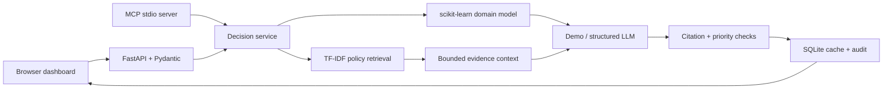

# Payment risk investigation desk


Payment-risk triage with logistic regression, held-out precision metrics, grounded LLM decisions, bounded RAG prompts, audit storage, MCP and Docker.

## The industry problem

Payment operations teams face high alert volumes and fragmented policy context. Analysts need consistent triage signals and cited reasons to prioritize investigation without treating a model score as proof of fraud.

**Who uses it:** an operations analyst and the accountable process owner in finance.
**What it produces:** an advisory decision, domain calculations, ML signals, cited policy excerpts, prompt-budget measurements and an auditable request record.

## End-to-end workflow

1. Select a seeded scenario or enter validated operational inputs in the browser dashboard.
2. Run the domain model and explicit decision rules.
3. Retrieve relevant local policy paragraphs with TF-IDF cosine similarity; deduplicate and fit them to a context budget.
4. Generate structured advice in demo mode or through the optional OpenAI Responses API.
5. Validate evidence citations and prevent the LLM from lowering mandatory review priority.
6. Display the result, record it in SQLite, and cache identical requests for one hour.



## Run locally

Requires Python 3.13. No API key is needed for the default demo.

```bash
git clone https://github.com/alavisaqib/finance-payment-risk-ai.git
cd finance-payment-risk-ai
python -m venv .venv
# macOS/Linux: source .venv/bin/activate
# Windows PowerShell: .venv\Scripts\Activate.ps1
python -m pip install -r requirements.txt
python -m uvicorn app.main:app --host 127.0.0.1 --port 8000
```

Open [the dashboard](http://localhost:8000) or [interactive API docs](http://localhost:8000/docs).
Seed data is committed. The model trains deterministically on first use, then stays in memory per process.

## Run with Docker

```bash
docker compose up --build
```

The API binds to localhost port 8000. Container state persists in the named volume. The process runs as an unprivileged user. To run multiple projects together, set a different `PORT` in each project's `.env` (8001, 8002, ...). See [deployment](docs/DEPLOYMENT.md) for server setup and checks.

## Try the API

```bash
curl -X POST http://localhost:8000/api/decisions -H "Content-Type: application/json" --data-binary @examples/request.json
curl "http://localhost:8000/api/search?q=payment"
curl http://localhost:8000/api/history
```

On Windows use `curl.exe`. If `APP_API_KEY` is set, add an `X-API-Key` header. `/api/meta` describes the complete input schema and model evaluation. The checked-in [example response](examples/response.json) is generated from this implementation.

## Enable live LLM decisions

Copy `.env.example` to `.env`; set `LLM_PROVIDER=openai`, `OPENAI_API_KEY`, and `OPENAI_MODEL` to a model available to your account that supports Responses structured outputs. Docker Compose loads these values automatically. For local Uvicorn use `python -m uvicorn app.main:app --env-file .env`.

Demo mode uses a deterministic evidence template and does **not** call an LLM. Live mode uses Pydantic structured output, `store=False`, a 30-second client timeout and one retry. Invalid citations, refusals and provider errors fail visibly. Live calls can incur cost; no paid calls are part of the default tests. Credentials belong in environment variables and are never committed.

## Token optimization

- Rank and pack relevant paragraphs instead of sending the entire policy corpus.
- Deduplicate identical chunks by content hash.
- Bound selected evidence to 1,000–2,400 UTF-8 bytes and the full prompt estimate plus 700 output units to 10,000.
- Cache by request, provider, model, source-code/training-data version and corpus hash, with a one-hour TTL.
- Report provider input/output tokens for live requests; cache hits record zero tokens for the current request.

The offline estimator conservatively uses UTF-8 text bytes plus a framing allowance, **not an exact tokenizer or billing estimate**. The displayed reduction measures prompt units, not measured dollar savings. Provider cache-discount pricing is not assumed.

## MCP tools

```bash
python -m app.mcp_server
```

The official MCP Python v1 SDK serves `search_policy`, `analyze_operation`, and `model_card` over stdio. Use an MCP host configuration like [mcp.example.json](mcp.example.json), replacing both absolute paths. `analyze_operation` writes a local audit record and can incur LLM cost in live mode. It does not execute external operations. Stdout is reserved for the protocol. This SDK is intentionally pinned below v2; migration requires updating and testing the client contract.

## Data science and evaluation

**Target:** `synthetic suspicious-payment label` (probability).

Labels come from a noisy logistic function of amount, velocity, account age and location distance. No customer data, protected attributes or genuine fraud outcomes are included.

Each repository includes 800 deterministic synthetic records, a 600/200 train/test split, and a reproducible seed. Classification uses standardized logistic regression and reports ROC AUC and average precision against class prevalence. Regression uses a random forest and reports MAE against a training-mean baseline. Metrics describe synthetic interpolation only.

```bash
python -m scripts.generate_data
python -m scripts.evaluate
python -m pytest -q
```

See [evaluation results](reports/evaluation.json), [model card](docs/MODEL_CARD.md), and [data dictionary](docs/DATA_DICTIONARY.md). Tests cover domain scenarios, malformed input, authentication, RAG ranking/budgets, caching, provider errors, structured-output handling, priority controls and an actual MCP stdio round trip. GitHub Actions also builds and smoke-tests the Docker image.

## Technology choices and role alignment

- **Python / scikit-learn:** reproducible modeling and metrics for a data scientist portfolio.
- **TF-IDF / cosine retrieval:** transparent local RAG baseline with no embedding download; dense retrieval is an extension, not an implemented claim.
- **OpenAI Responses / Pydantic:** structured advisory decisions for AI engineering.
- **FastAPI / Uvicorn:** typed REST API, schema validation and ASGI serving.
- **SQLite:** request persistence and cache; simple single-instance deployment.
- **MCP:** interoperable tool access with a real protocol test.
- **HTML / CSS / JavaScript:** responsive dashboard with no frontend build tooling.
- **Docker Compose / GitHub Actions:** reproducible container deployment and continuous verification.

Interview walkthrough: explain the business failure mode, demonstrate a normal and escalated scenario, inspect citations, repeat a request to show caching, examine held-out metrics, and discuss production validation limits. No impact or employment claims are implied by this demonstration.

## Scope and extension path

This is a runnable portfolio prototype using fictional policies and synthetic data. It is not a validated clinical, financial or compliance system. External approvals and transactions are outside its scope. For real deployment, replace sample policies with authorized documents, validate against real outcomes, add organization identity/access controls, move shared state to a managed database, and add monitoring and retention controls. See [architecture](docs/ARCHITECTURE.md) and [deployment](docs/DEPLOYMENT.md).

## Technical references

- [FastAPI container deployment](https://fastapi.tiangolo.com/deployment/docker/)
- [Official MCP Python SDK](https://github.com/modelcontextprotocol/python-sdk/tree/v1.x)
- [OpenAI structured outputs](https://developers.openai.com/api/docs/guides/structured-outputs)
- [scikit-learn evaluation](https://scikit-learn.org/stable/modules/model_evaluation.html)

MIT licensed. Synthetic data and fictional policy texts are included under the same license.
